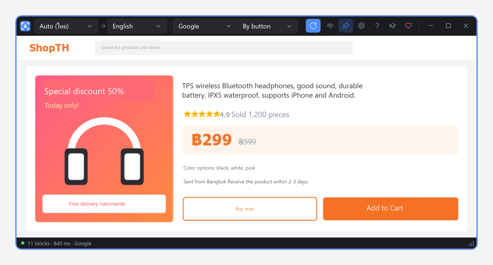

# Glass Translate

[](../../releases/latest)
[](../../releases)

[](https://ko-fi.com/dmakhazen)
[](https://boosty.to/dmakhazen/donate)

A transparent frame for Windows that translates any text under it, including text inside images, and draws the translation right over the original.



**[English](#english) · [Русский](#русский)**

---

## English

### What it does
- Put the frame over a web page, picture, game or PDF and the text inside is translated in place.
- Reads text from the screen (OCR), so text in images works too. Doesn't depend on Windows language packs.
- Free engines, no keys or sign-up: **Google**, **Bing**, **MyMemory**. Optional **Ollama** (local AI, offline).
- Source language: auto-detect or fixed. 22 target languages. Interface in 10 languages.
- Translates every 1–10 s or on a button. A short tour explains the controls on first start.

### Download
Grab the zip from [Releases](../../releases), unzip and run `GlassTranslate.exe`. It's portable: nothing to install, settings are saved next to the exe. Windows 10 (2004+) or 11, x64.

### Limitations
- Google, Bing and MyMemory are free but unofficial endpoints: they can slow down or refuse for a while. Switch the engine if you see errors.
- Text inside the frame is sent to the selected online service (except Ollama).
- Very small, blurry or vertical text isn't recognized.
- Thai, English, Cyrillic and Latin are built in; Chinese, Japanese, Korean, Greek, Hindi and Arabic download once on first use.
- Translations don't show up in screenshots (the overlay is hidden from screen capture so it can re-read the page).

### Support
If it helps you: [Ko-fi](https://ko-fi.com/dmakhazen) · [Boosty](https://boosty.to/dmakhazen/donate)

---

## Русский

### Что умеет
- Наведите рамку на страницу, картинку, игру или PDF, и текст внутри переведётся прямо на месте.
- Читает текст с экрана (OCR), поэтому переводит и надписи на картинках. Не зависит от языковых пакетов Windows.
- Бесплатные сервисы без ключей и регистрации: **Google**, **Bing**, **MyMemory**. По желанию **Ollama** (локальная нейросеть, офлайн).
- Язык оригинала определяется автоматически или задаётся вручную. 22 языка перевода, интерфейс на 10 языках.
- Перевод каждые 1–10 секунд или по кнопке. При первом запуске короткий тур объясняет все элементы.

### Скачать
Скачайте zip в [Releases](../../releases), распакуйте и запустите `GlassTranslate.exe`. Программа portable: ничего не устанавливается, настройки хранятся рядом с exe. Windows 10 (2004+) или 11, x64.

### Ограничения
- Google, Bing и MyMemory бесплатны, но это неофициальные адреса: иногда они тормозят или временно отказывают. При ошибках смените сервис.
- Текст из рамки отправляется выбранному онлайн-сервису (кроме Ollama).
- Очень мелкий, размытый или вертикальный текст не распознаётся.
- Тайский, английский, кириллица и латиница встроены; китайский, японский, корейский, греческий, хинди и арабский скачиваются один раз при первом выборе.
- Перевод не виден на скриншотах (слой с переводом скрыт от захвата экрана, чтобы программа могла перечитывать страницу).

### Поддержать
Если программа помогает: [Ko-fi](https://ko-fi.com/dmakhazen) · [Boosty](https://boosty.to/dmakhazen/donate)

---

## Building / Сборка

Requires the .NET 10 SDK. / Нужен .NET 10 SDK.

```powershell
.\build-portable.ps1   # downloads OCR models once, then -> dist\GlassTranslate-<version>-portable-win-x64.zip
```

Pushing a tag like `v0.1.0` builds the zip on GitHub Actions and publishes it as a release. / Пуш тега вида `v0.1.0` собирает zip в GitHub Actions и публикует релиз.

Diagnostics: `GLASS_LOG=1` writes `glass.log` next to the exe.

## Credits
OCR: [PaddleOCR](https://github.com/PaddlePaddle/PaddleOCR) PP-OCRv5 models (Apache-2.0), ONNX conversions from [monkt/paddleocr-onnx](https://huggingface.co/monkt/paddleocr-onnx), run with [ONNX Runtime](https://github.com/microsoft/onnxruntime) (MIT).
